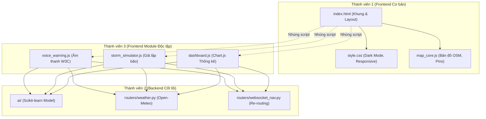

# 📋 Kế Hoạch Phân Công Công Việc & Chiến Lược Git (FloodNav Team)

> [!IMPORTANT]
> **Mục tiêu cốt lõi**:
> - Đúng người đúng việc: Thành viên 1 (Dễ, nhẹ nhàng, Frontend cơ bản), Thành viên 2 (Trọng tâm, cốt lõi Backend), Thành viên 3 (Độc lập, ít áp lực, tính năng Frontend chuyên biệt).
> - **Triệt tiêu xung đột mã nguồn (Zero Merge Conflict)** bằng cách phân tách ranh giới thư mục và module file độc lập 100%.

---

## 1. Chiến lược Tách File Triệt Tiêu Xung Đột Git (Zero-Conflict Architecture)

Nguyên nhân lớn nhất gây xung đột Git là **cả nhóm cùng sửa chung một file** (như nhét tất cả code vào duy nhất `index.html` hoặc `main.py`). 

Chúng ta cấu trúc lại hệ thống thành các module độc lập. Mỗi thành viên chỉ làm việc trong khu vực file của mình:

```
floodnav/
├── backend/app/
│   ├── main.py                     # [Chung] Chỉ định tuyến router (Người 2 kiểm soát)
│   ├── routers/
│   │   ├── weather.py              # [Thành viên 2] API thời tiết Open-Meteo
│   │   ├── prediction.py           # [Thành viên 2] API dự báo ngập AI
│   │   └── websocket_nav.py        # [Thành viên 2] WebSocket Re-routing thời gian thực
│   ├── ai/
│   │   ├── train_model.py          # [Thành viên 2] Huấn luyện Scikit-learn
│   │   └── model.pkl
│   └── static/
│       ├── index.html              # [Thành viên 1] Khung HTML, Layout chính
│       ├── css/
│       │   └── style.css           # [Thành viên 1] CSS tùy chỉnh, Dark mode, Animation
│       └── js/
│           ├── map_core.js         # [Thành viên 1] Khởi tạo bản đồ OpenStreetMap, Marker cơ bản
│           ├── voice_warning.js    # [Thành viên 3] Module Cảnh báo giọng nói (Web Speech)
│           ├── storm_simulator.js  # [Thành viên 3] Module Bộ giả lập mưa bão
│           └── dashboard.js        # [Thành viên 3] Module Biểu đồ thống kê ngập đô thị
```



---

## 2. Bảng Phân Công Công Việc Chi Tiết (Work Breakdown Structure)

### 👤 Thành viên 1: Frontend Cơ bản & Giao diện (Junior / Người mới)
*Đặc điểm: Việc vừa sức, rõ ràng, tập trung vào giao diện thị giác, không đòi hỏi thuật toán phức tạp.*

| Mã Task | Tên công việc | Mô tả chi tiết | File tác động | Tiêu chí nghiệm thu (DoD) | Trạng thái |
|---|---|---|---|---|---|
| **FE-01** | Khắc phục nền bản đồ sạch (OSM Tiles) | Chuyển toàn bộ Tile layer sang OpenStreetMap sạch, bỏ hẳn CartoDB watermark, kiểm tra zoom in/out mượt mà tại Hà Nội. | `static/js/map_core.js` | Không còn vệt chữ `API KEY REQUIRED`, bản đồ nét từng tuyến phố. | Sẵn sàng |
| **FE-02** | Thiết kế Floating Navbar & Header | Tạo thanh Header nổi bo tròn (Floating Card), hiển thị logo FloodNav, trạng thái kết nối PostGIS, nút chuyển tab nhanh. | `static/index.html`<br>`static/css/style.css` | Header dạng thẻ nổi hiện đại, có responsive trên di động. | Sẵn sàng |
| **FE-03** | Chế độ Bản đồ Ngày / Đêm (Dark Mode) | Thêm nút Toggle Dark Mode; khi bật, đổi tile bản đồ sang nền tối và đổi tông màu giao diện sang Slate-900. | `static/css/style.css`<br>`static/js/map_core.js` | Nhấn chuyển mượt mà giữa chế độ sáng và chế độ lái xe ban đêm. | Sẵn sàng |
| **FE-04** | Hiệu ứng Vùng ngập nước (Pulsing Radius) | Khi hiển thị 8 điểm ngập, vẽ thêm một vòng tròn bán kính ảnh hưởng (`L.circle`) phát sáng nhấp nháy đỏ/cam theo độ sâu. | `static/js/map_core.js` | Điểm ngập có quầng sáng lan tỏa trực quan trên mặt đường. | Sẵn sàng |
| **FE-05** | Thiết kế Form Báo ngập & Hướng dẫn | Tinh chỉnh giao diện hộp thoại báo ngập cộng đồng, thêm pop-up hướng dẫn ngắn khi người dùng mới mở trang. | `static/index.html` | Form đẹp, có icon trực quan, dễ thao tác với 1 cú click. | Sẵn sàng |

---

### 👤 Thành viên 2: Backend Cốt lõi, Dữ liệu & AI (Senior / Trụ cột)
*Đặc điểm: Phụ trách toàn bộ logic quan trọng, thuật toán, dữ liệu mở và mô hình AI để bảo đảm tính đột phá khoa học của đề tài.*

| Mã Task | Tên công việc | Mô tả chi tiết | File tác động | Tiêu chí nghiệm thu (DoD) | Trạng thái |
|---|---|---|---|---|---|
| **BE-01** | Tích hợp API Thời tiết Nguồn mở (Open-Meteo) | Viết router gọi API Open-Meteo (100% mở, không cần key) lấy dự báo lượng mưa Hà Nội (mm/h) trong 24 giờ tới. | `backend/app/routers/weather.py`<br>`backend/app/main.py` | Endpoint `GET /api/weather/hanoi` trả về JSON lượng mưa chuẩn. | Sẵn sàng |
| **BE-02** | Xây dựng Mô hình AI Dự báo Mực nước | Dùng **Scikit-learn** huấn luyện mô hình dự báo mực nước sau 30 và 60 phút dựa trên lượng mưa + mực nước lịch sử. | `backend/app/ai/`<br>`backend/app/routers/prediction.py` | Endpoint `GET /api/predictions` trả về mực nước dự báo & điểm rủi ro. | Sẵn sàng |
| **BE-03** | Logic Tự động Chặn đường Dự báo | Kết nối kết quả dự báo AI vào đồ thị NetworkX: nếu sau 30 phút điểm ngập sẽ vượt ngưỡng thì tự động khóa cạnh đường trước. | `backend/app/routing.py` | Thuật toán định tuyến né được cả những điểm sắp ngập trong tương lai. | Sẵn sàng |
| **BE-04** | Kênh WebSocket Re-Routing thời gian thực | Thiết lập endpoint WebSocket `/ws/navigation/{session_id}` để đẩy lộ trình mới xuống client khi có điểm ngập mới phát sinh. | `backend/app/routers/websocket_nav.py`<br>`backend/app/main.py` | Kết nối WebSocket ổn định, phát sự kiện `route_updated` khi có thay đổi. | Sẵn sàng |
| **BE-05** | Viết Test tự động & Benchmark | Viết bộ kiểm thử tự động (Pytest hoặc `tests.http`) kiểm tra tính đúng đắn của giải thuật Dijkstra với trọng số ngập. | `tests/`<br>`tests.http` | 100% test case tìm đường cho xe máy/ô tô pass, có báo cáo hiệu năng. | Sẵn sàng |

---

### 👤 Thành viên 3: Tính năng Chuyên biệt & Tiện ích Frontend (Intermediate / Độc lập)
*Đặc điểm: Có kinh nghiệm nhưng ít thời gian, phụ trách các module tính năng "ăn điểm khi demo" tách rời hoàn toàn, không phải chờ ai và không block ai.*

| Mã Task | Tên công việc | Mô tả chi tiết | File tác động | Tiêu chí nghiệm thu (DoD) | Trạng thái |
|---|---|---|---|---|---|
| **FE-MOD-01** | Module Cảnh báo Giọng nói Tiếng Việt | Viết file JS độc lập sử dụng **Web Speech Synthesis API** chuẩn W3C, phát âm thanh cảnh báo khi xe chuẩn bị vào đoạn ngập. | `static/js/voice_warning.js` | Trình duyệt phát ra giọng đọc tiếng Việt rõ ràng, có nút Tắt/Bật loa trên UI. | Sẵn sàng |
| **FE-MOD-02** | Module Bộ Giả lập Mưa bão (Storm Simulator) | Viết bộ điều khiển kịch bản bão với thanh trượt lượng mưa; khi kéo, tự động gửi API thay đổi mực nước các cảm biến hàng loạt. | `static/js/storm_simulator.js` | Kéo thanh trượt thì mực nước 8 điểm tự tăng/giảm đồng bộ, kích hoạt tính lại đường. | Sẵn sàng |
| **FE-MOD-03** | Mô phỏng Xe di chuyển trên đường | Vẽ icon xe máy / ô tô di chuyển từng đoạn dọc theo lộ trình đã tìm (`requestAnimationFrame` / `setInterval`). | `static/js/map_core.js` (gọi hàm ngoài) | Icon xe chạy mượt mà từ điểm đi đến điểm đến theo đúng tọa độ tuyến đường. | Sẵn sàng |
| **FE-MOD-04** | Dashboard Thống kê Đô thị (Chart.js) | Tích hợp Chart.js hiển thị modal thống kê: Biểu đồ cột mực nước 8 điểm, biểu đồ tròn tỷ lệ an toàn/nguy hiểm theo quận. | `static/js/dashboard.js` | Popup Dashboard hiển thị biểu đồ đẹp, dữ liệu lấy tự động từ `/api/flood-points`. | Sẵn sàng |

---

## 3. Quy Trình Phối Hợp Git Tránh Xung Đột (Git Workflow Guide)

Để đảm bảo không bao giờ gặp lỗi xung đột (Merge Conflict), cả 3 thành viên bắt buộc tuân thủ 4 quy tắc vàng:

### Quy tắc 1: Mỗi người một nhánh riêng (Feature Branches)
- Nhánh chính: `main` (chỉ merge khi code đã chạy tốt).
- **Thành viên 1**: tạo và làm trên nhánh `feature/ui-modern-layout`
- **Thành viên 2**: tạo và làm trên nhánh `feature/backend-ai-weather`
- **Thành viên 3**: tạo và làm trên nhánh `feature/voice-simulator-dashboard`

```bash
# Lệnh tạo và chuyển sang nhánh riêng:
git checkout -b feature/ui-modern-layout       # Người 1
git checkout -b feature/backend-ai-weather     # Người 2
git checkout -b feature/voice-simulator       # Người 3
```

### Quy tắc 2: Ranh giới file tuyệt đối (File Isolation)
- **Thành viên 1**: Chỉ chỉnh sửa `index.html`, `style.css`, `map_core.js`.
- **Thành viên 2**: Chỉ làm việc trong thư mục `backend/app/routers/` (các file mới) và `backend/app/ai/`. Không đụng vào thư mục `static/`.
- **Thành viên 3**: Chỉ viết code trong các file JS riêng biệt: `voice_warning.js`, `storm_simulator.js`, `dashboard.js`. Ở file `index.html`, chỉ cần Thành viên 1 thêm sẵn 3 dòng nhúng thẻ script ở cuối:
  ```html
  <script src="/static/js/voice_warning.js"></script>
  <script src="/static/js/storm_simulator.js"></script>
  <script src="/static/js/dashboard.js"></script>
  ```
  Nhờ vậy, Thành viên 3 hoàn toàn không cần đụng vào file `index.html` của Thành viên 1!

### Quy tắc 3: Quy trình cập nhật hàng ngày (Daily Sync)
Mỗi ngày trước khi bắt đầu viết code:
```bash
git checkout main
git pull origin main
git checkout <nhánh-của-mình>
git merge main
```

### Quy tắc 4: Giao tiếp qua Hợp đồng API (API Contract First)
- Thành viên 2 cung cấp tài liệu Swagger ([http://localhost:8000/docs](http://localhost:8000/docs)) định nghĩa rõ JSON đầu vào và đầu ra.
- Thành viên 1 và 3 chỉ việc gọi đúng đường dẫn API đó. Khi Backend chưa xong, Thành viên 1 và 3 có thể dùng dữ liệu giả lập (mock data) để hoàn thiện giao diện mà không cần chờ đợi.
